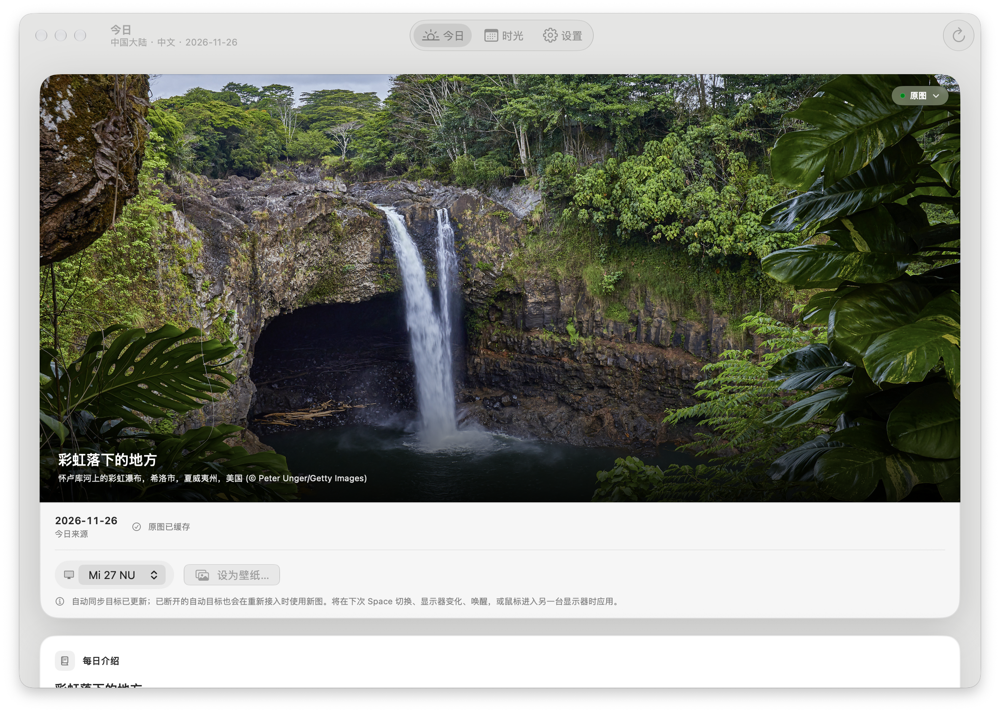
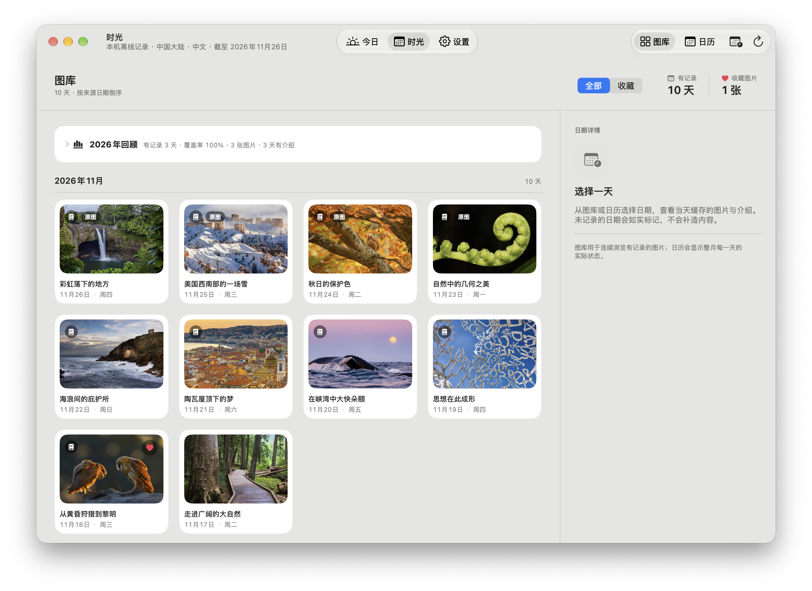
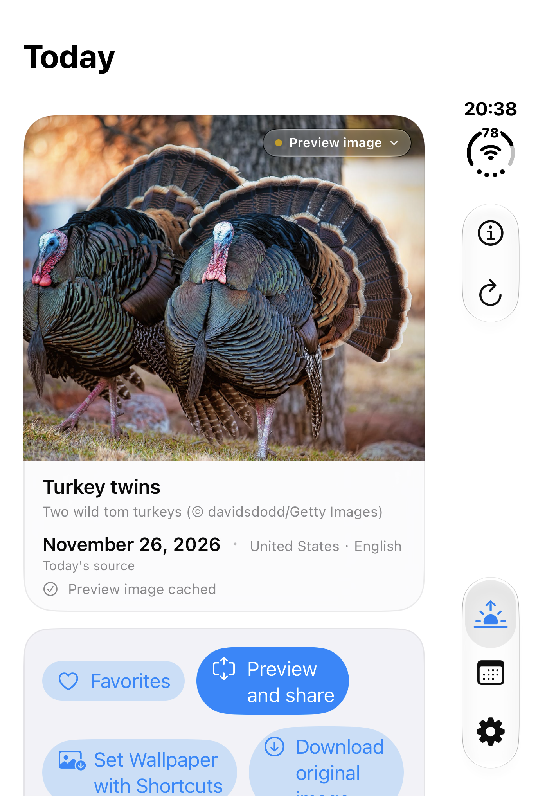
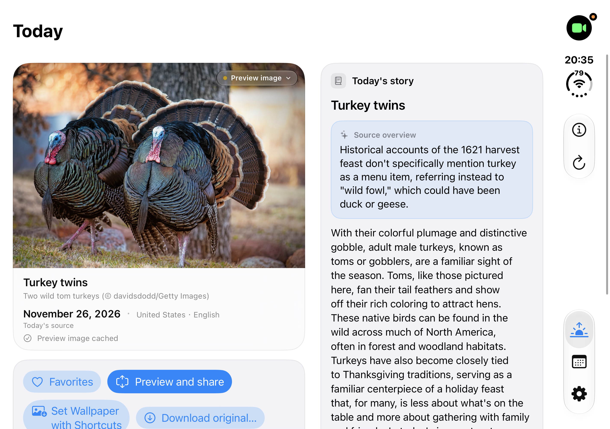

# Daybreak

<p align="center">
  
</p>

<p align="center">A modern Bing daily wallpaper client for Mac, iPhone and iPad.</p>

<p align="center">
  <a href="README.zh-CN.md">简体中文</a> ·
  <a href="docs/README.md">Documentation</a> ·
  <a href="CONTRIBUTING.md">Contributing</a>
</p>

## See Daybreak

Daybreak is a modern Bing client for Apple platforms. Browse the daily image and its source-provided introduction, revisit previous days, save favorites, and move the image into the system wallpaper workflow.

### Mac

<table>
  <tr>
    <td width="50%" align="center"><br><sub>Today</sub></td>
    <td width="50%" align="center"><br><sub>Timeline</sub></td>
  </tr>
</table>

### iPad

<table>
  <tr>
    <td width="50%" align="center"><br><sub>Today</sub></td>
    <td width="50%" align="center"><br><sub>Timeline</sub></td>
  </tr>
</table>

### iPhone Duo

<table>
  <tr>
    <td width="25%" align="center"><br><sub>Outer display · Today</sub></td>
    <td width="25%" align="center"><br><sub>Outer display · Timeline</sub></td>
    <td width="25%" align="center"><br><sub>Inner display · Today</sub></td>
    <td width="25%" align="center"><br><sub>Inner display · Timeline</sub></td>
  </tr>
</table>

## Features

- **Daily wallpapers and stories** — enjoy Bing's daily image, read its story and explore photo credits and sources.
- **Calendar and recaps** — revisit saved wallpapers and stories by date, collect favorites and look back on your discoveries.
- **Automatic wallpaper on macOS** — set wallpapers across multiple displays and, when automatic management is enabled, reconcile the wallpaper as you switch Spaces.
- **Shortcuts on iPhone and iPad** — run a shortcut to set a wallpaper manually, or create a Shortcuts automation to update it on your schedule.
- **Sync across devices** — choose an iCloud Drive folder to share favorites, pinned dates and archived content between Mac, iPhone and iPad.
- **Offline browsing** — enjoy cached images and stories even without a connection.

## Local-first by design

Daybreak has no account system, backend, telemetry or bundled Bing archive. Bing services are unofficial integration points, so dates, images and editorial details may be missing or change at the source. Cached content remains available offline, while recaps describe only what the device actually observed.

Bing images and text remain the property of their respective rights holders. The MIT license covers the project code only. Daybreak is independent and is not affiliated with Microsoft or Bing.

## Platform boundaries

- iOS and iPadOS do not directly change system wallpaper from the app. Shortcuts performs that system action and may require user confirmation, preview or automation configuration.
- macOS updates accessible displays and reconciles wallpaper after public display and Space events. Inactive Spaces are not guaranteed to update immediately.
- Folder sync is opt-in. Real-device propagation, free-account re-signing persistence, complete multi-display reconciliation and full Duo behavior remain device checks rather than claims made by the source build.

## Build from source

The Xcode project is generated from `Apps/MacApp/project.yml` with XcodeGen 2.40 or newer:

```sh
xcodegen generate -s Apps/MacApp/project.yml -r . -p .
open Daybreak.xcodeproj
```

Build macOS without signing:

```sh
xcodebuild -project Daybreak.xcodeproj -scheme Daybreak \
  -destination 'platform=macOS' CODE_SIGNING_ALLOWED=NO build
```

Compile the iOS target against the installed device SDK without signing:

```sh
xcodebuild -project Daybreak.xcodeproj -scheme DaybreakMobile \
  -destination 'generic/platform=iOS' CODE_SIGNING_ALLOWED=NO build
```

An unsigned iOS build requires user signing before installation. Test commands and release constraints are documented in [CONTRIBUTING.md](CONTRIBUTING.md) and the [documentation index](docs/README.md).

## License

The project code is available under the [MIT License](LICENSE).
