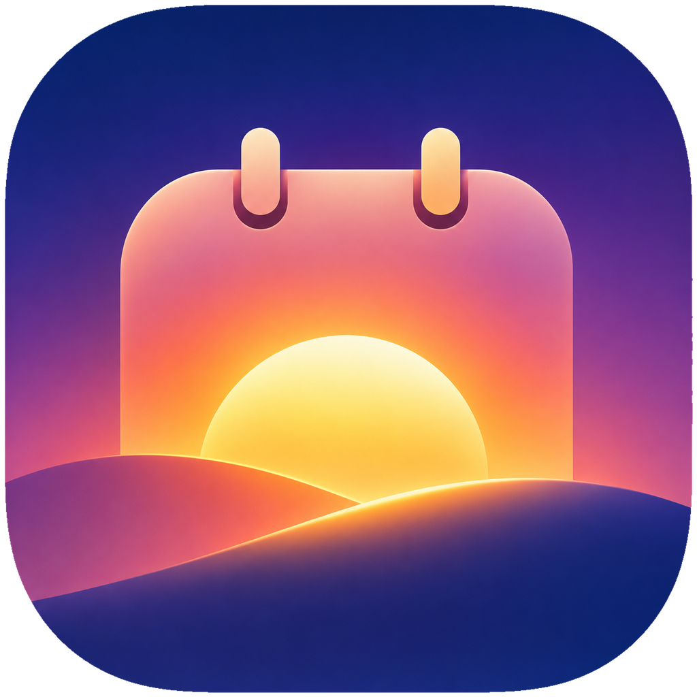
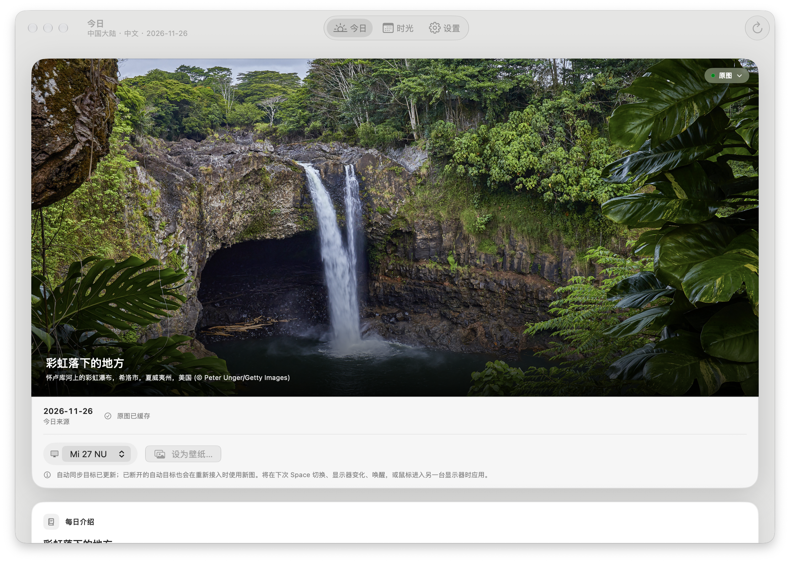
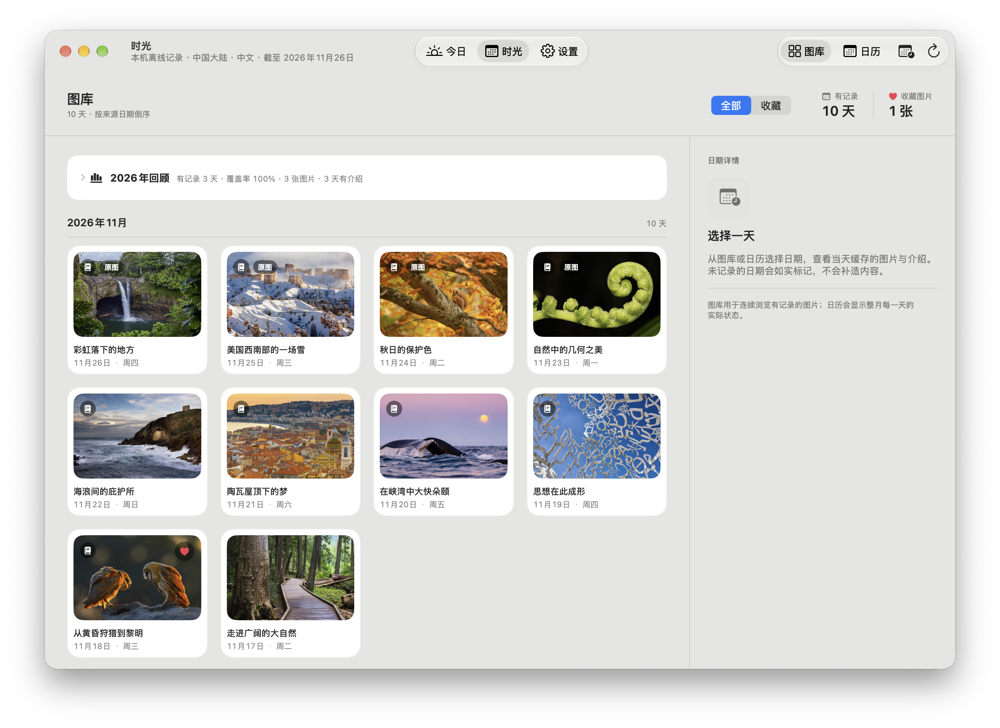
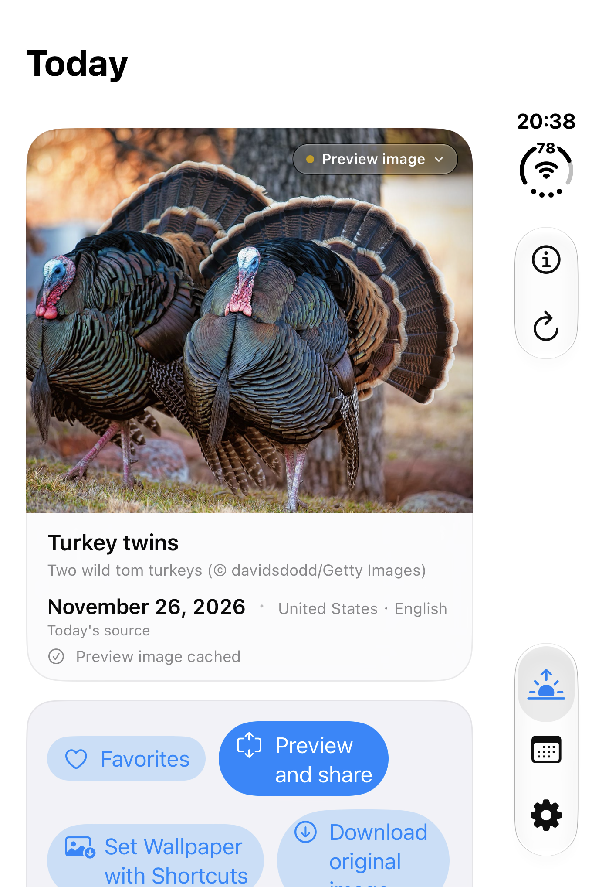
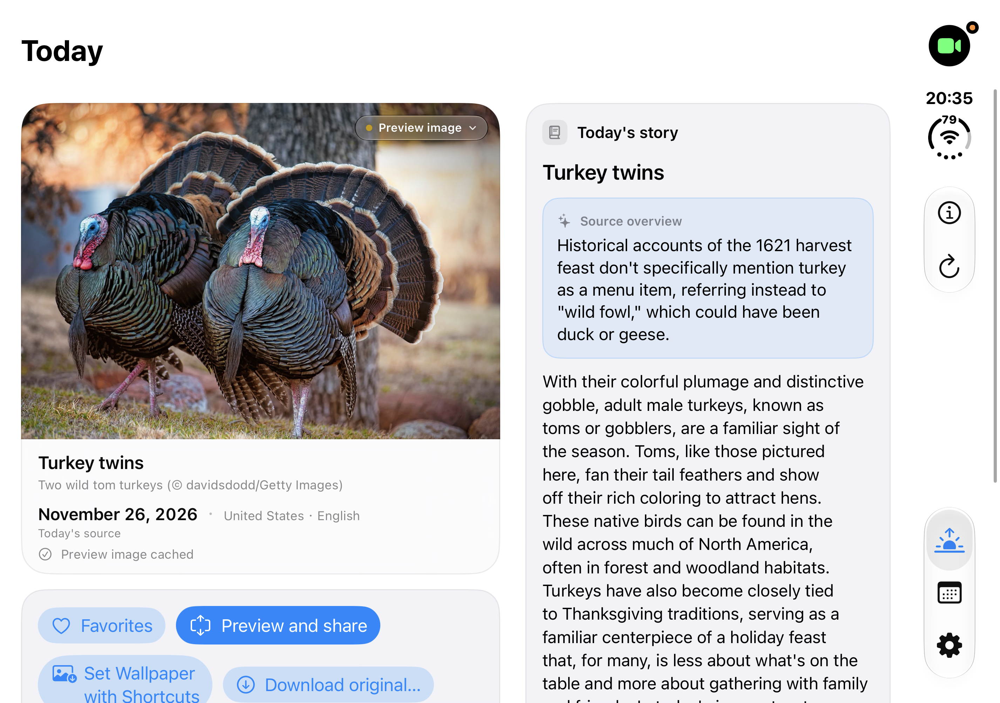

# Daybreak

<p align="center">
  
</p>

<p align="center">现代化 Bing 每日壁纸客户端，支持 Mac、iPhone 和 iPad。</p>

<p align="center">
  <a href="README.md">English</a> ·
  <a href="docs/README.zh-CN.md">文档索引</a> ·
  <a href="CONTRIBUTING.zh-CN.md">参与贡献</a>
</p>

## 先看 Daybreak

Daybreak 是面向 Apple 平台的现代化 Bing 每日壁纸客户端。浏览每日图片和来源介绍，回看往期内容，收藏喜欢的图片，并通过系统工作流设置壁纸。

### Mac

<table>
  <tr>
    <td width="50%" align="center"><br><sub>今日</sub></td>
    <td width="50%" align="center"><br><sub>时光</sub></td>
  </tr>
</table>

### iPad

<table>
  <tr>
    <td width="50%" align="center"><br><sub>今日</sub></td>
    <td width="50%" align="center"><br><sub>时光</sub></td>
  </tr>
</table>

### iPhone Duo

<table>
  <tr>
    <td width="25%" align="center"><br><sub>外屏 · 今日</sub></td>
    <td width="25%" align="center"><br><sub>外屏 · 时光</sub></td>
    <td width="25%" align="center"><br><sub>内屏 · 今日</sub></td>
    <td width="25%" align="center"><br><sub>内屏 · 时光</sub></td>
  </tr>
</table>

## 功能亮点

- **每日壁纸与介绍**：欣赏 Bing 每日图片，阅读背后的故事，查看摄影版权和来源。
- **时光日历与回顾**：按日期浏览已保存的壁纸和介绍，收藏喜欢的图片，回顾自己的发现。
- **macOS 自动换壁纸**：支持为多个显示器设置壁纸，并在启用自动管理后跟随桌面空间切换重新协调壁纸。
- **iPhone 和 iPad 快捷指令**：手动运行快捷指令设置壁纸，或在系统快捷指令中创建自动化，让壁纸按你设定的时间更新。
- **多端同步**：选择 iCloud Drive 文件夹，在 Mac、iPhone 和 iPad 之间同步收藏、固定日期及已归档内容。
- **离线浏览**：图片和介绍缓存到本机后，断网时也能继续欣赏。

## 本地优先

Daybreak 没有账号系统、后端、遥测或内置 Bing 档案。Bing 服务属于非正式集成，日期、图片和介绍可能缺失或变化。缓存内容可在离线时继续浏览，回顾只描述设备实际观察到的记录。

Bing 图片和文字仍归各自权利人所有。MIT 许可证只适用于项目代码。Daybreak 是独立项目，与 Microsoft 或 Bing 没有官方关联。

## 平台边界

- iOS 和 iPadOS 不会由应用直接更改系统壁纸。快捷指令负责执行系统操作，可能需要用户确认、预览或配置自动化。
- macOS 更新可访问的显示器，并在公开的显示器和 Space 事件后重新协调壁纸。不能保证未激活的 Space 立即更新。
- 文件夹同步默认关闭，只有用户选择文件夹并启用后才运行。跨设备传播、免费账号重签后的授权持久性、完整多显示器协调和完整 Duo 行为仍属于设备验证项。

## 从源码构建

Xcode 工程由 XcodeGen 2.40 或更高版本根据 `Apps/MacApp/project.yml` 生成：

```sh
xcodegen generate -s Apps/MacApp/project.yml -r . -p .
open Daybreak.xcodeproj
```

不签名构建 macOS：

```sh
xcodebuild -project Daybreak.xcodeproj -scheme Daybreak \
  -destination 'platform=macOS' CODE_SIGNING_ALLOWED=NO build
```

使用已安装的 iOS 设备 SDK 编译移动端：

```sh
xcodebuild -project Daybreak.xcodeproj -scheme DaybreakMobile \
  -destination 'generic/platform=iOS' CODE_SIGNING_ALLOWED=NO build
```

未签名的 iOS 构建需要用户自行签名后才能安装。测试命令和发布限制见[贡献指南](CONTRIBUTING.zh-CN.md)与[文档索引](docs/README.zh-CN.md)。

## 许可证

项目代码采用 [MIT 许可证](LICENSE)。
